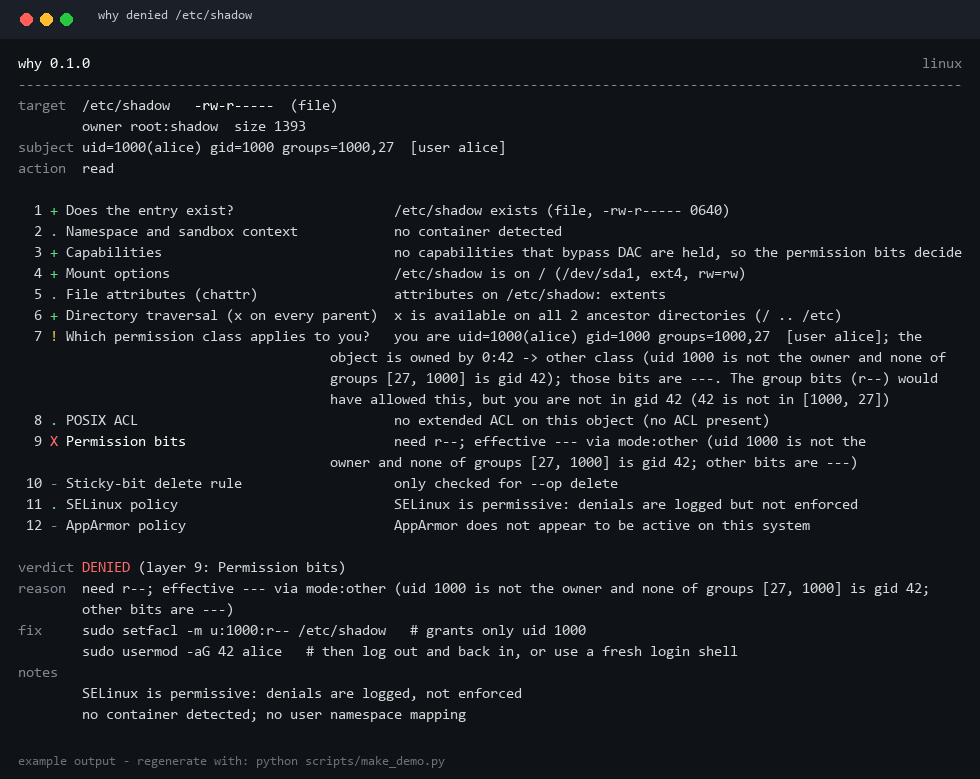

# why

**`Permission denied` 到底是哪一层拦的你？怎么修？**

[](https://github.com/xin0803-z/why/actions/workflows/ci.yml)
[](LICENSE)
[](pyproject.toml)
[](pyproject.toml)

`why` 会把一次访问请求按**内核实际检查的顺序**逐层过一遍：路径穿越 → 属主与组 → 权限位 → POSIX ACL 与它的 mask → capabilities → `chattr` 属性 → 挂载选项 → namespace → SELinux / AppArmor，然后告诉你**是哪一层说了不**。

真实运维中绝大多数的 `Permission denied`，都不是 `ls -l` 上能看见的那几个权限位：可能是**爷爷目录少了 `x`**、可能是**一次 `chmod` 悄悄改写了 ACL mask**、可能是**容器里的 root 并不是 root**、也可能是文件被 `chattr +i` 锁死了。这些 `why` 都会按内核顺序替你查一遍。



<sub>示例输出，可用 `python scripts/make_demo.py` 重新生成。</sub>

```console
$ why denied /etc/shadow
verdict DENIED (layer 9: Permission bits)
reason  need r--; effective --- via mode:other (uid 1000 is not the owner and none of
        groups [27, 1000] is gid 42; other bits are ---)
fix     sudo setfacl -m u:1000:r-- /etc/shadow   # 只授权给 uid 1000
        sudo usermod -aG 42 alice   # 然后重新登录（组关系要新会话才生效）
```

---

## 安装

```bash
pipx install why-linux      # 推荐，装完就有 why 命令
# 或者
uv tool install why-linux
# 或者
pip install --user why-linux
```

从源码装（除标准库外零依赖）：

```bash
git clone https://github.com/xin0803-z/why && cd why
pipx install .
```

> PyPI 上叫 `why-linux`（`why` 已被占用），命令仍然是 `why`。需要 Python 3.9+（RHEL 9 自带的 3.9 就能跑）。

**零运行时依赖，全程只读**：`why` 不会修改任何权限、标签或文件，只打印你可以执行的命令。

## 快速上手

```bash
why denied /etc/shadow                      # 为什么读不了？
why denied /etc/shadow --op write           # 为什么写不了？
why denied /var/www/html/new.txt --op create  # 能不能创建？（路径不存在时默认按创建判断）
why denied /srv/data --user www-data        # 以另一个用户的身份解释
why denied /srv/data --pid 1234             # 以某个运行中进程的身份解释（含它的 namespace）
why denied /etc/hosts --json | jq .deciding_layer
why denied /srv/data --check                # 静默模式：被拒退出码 1，适合写脚本
why layers                                  # 列出这 12 层（按内核顺序）
```

### 在脚本里用

```bash
if why denied /backup/dump.sql --check; then
  echo "备份可读"
else
  echo "备份不可读：" ; why denied /backup/dump.sql   # 打印完整归因
fi
```

`--check` 采用**失败即拒绝**（fail closed）策略：结论无法确定时（普通模式下退出码 `11`）同样返回 `1` —— 门禁不应该对"答不上来的问题"放行。此时 stderr 打印的是 `unknown`，而不是谎称"被拒绝"。

| 退出码 | 含义 |
| ------ | ---- |
| `0` | 成功给出归因（`denied`，或依据内核审计记录的 `denied-by-evidence`） |
| `1` | 用法错误；或 `--check` 发现访问会被拒绝 |
| `2` | 内部错误 |
| `10` | 本模型的 12 层都不拒绝这次访问 |
| `11` | 无法给出结论（例如当前不是 Linux 主机） |

## 这 12 层分别在抓什么

| # | 层 | 它抓到的典型坑 |
| - | -- | -------------- |
| 1 | 目标是否存在 | 把 `ENOENT` 误当权限问题；悬空软链接 |
| 2 | Namespace / 沙箱上下文 | 容器里的 root 不等于宿主 root、`no_new_privs`、seccomp、Landlock |
| 3 | Capabilities | `--cap-drop=ALL` 会让 root 失去特权；`CAP_DAC_READ_SEARCH` 只给读不给写 |
| 4 | 挂载选项 | `ro`（那是 `EROFS` 不是 `EACCES`）、`noexec`（**这个才是** `EACCES`）、`nosuid`、NFS `root_squash` |
| 5 | 文件属性 | `chattr +i` **连 root 都拒**；`+a` 只允许追加 |
| 6 | 目录穿越 | 爷爷目录少了 `x` |
| 7 | 你是哪一个权限类别 | 你不在那个组里 —— 而组权限本来是够的 |
| 8 | POSIX ACL | 一次 `chmod` 改写了 mask，把授权静默抹掉 |
| 9 | 权限位 | 最基础的属主/模式判定（含 root 的特殊规则） |
| 10 | 粘滞位删除规则 | `/tmp` 语义：只有文件属主、目录属主或 root 能删 |
| 11 | SELinux 策略 | 命中目标的 AVC `denied` 记录 |
| 12 | AppArmor 策略 | 主体所运行 profile 的 `DENIED` 记录 |

每一层都会给出**依据**，结论里点名**最终决定的那一层**。

### 关于"结论的可信度"，我们说实话

`why` 明确区分"我确定的"和"我怀疑的"：

* **decisive（确定）** —— 本次运行可判定，内核必然拒绝（权限位、父目录 `x`、`ro`、immutable、粘滞位）。
* **evidence（有证据）** —— 有近期内核拒绝记录（SELinux AVC / AppArmor）与该路径匹配，报告为 `denied-by-evidence`，**绝不当成预测**。
* **advisory（提示）** —— 值得知道的上下文，例如"SELinux 处于 enforcing，仍可能拒绝你，但没找到记录"。

另一个进程的 Landlock 规则、NFS 服务端的行为，`why` 看不到 —— 它会直说，而不是猜。

## JSON 输出

```console
$ why denied /etc/shadow --json
{
  "tool": "why",
  "version": "0.1.0",
  "verdict": "denied",
  "deciding_layer": "mode",
  "reason": "need r--; effective --- via mode:other (...)",
  "subject": { "uid": 1000, "gid": 1000, "groups": [1000, 27], "caps_eff": [] },
  "target": { "path": "/etc/shadow", "mode": 416, "mode_string": "-rw-r-----", "uid": 0, "gid": 42 },
  "layers": [ { "id": "exists", "index": 1, "status": "ok", "confidence": "decisive", ... } ],
  "fixes": ["sudo setfacl -m u:1000:r-- /etc/shadow"]
}
```

字段名稳定，每层一个对象，适合接 CI 门禁，也适合直接喂给 AI agent。

## 与现有工具的区别

| 工具 | 它能回答什么 |
| ---- | ------------ |
| `ls -l` / `stat` | 权限位是什么 |
| `namei -l` | 每级路径的模式（不含 ACL、root 特殊规则、挂载选项） |
| `getfacl` | ACL 条目（mask 得你自己算） |
| `lsattr` | 文件属性（前提是你想得到去跑它） |
| `ausearch` / `audit2why` | SELinux 拒绝（只管 SELinux） |
| `strace` | 哪个 syscall 失败了（但不说为什么） |
| **`why`** | **12 层里到底是哪一层拒绝的，附证据和修复建议** |

## 局限（明说）

* 用户态无法预测 MAC 判定：`why` 判定 DAC，并引用 MAC 的证据。
* 无法读取其他进程内部的 Landlock / BPF 策略。
* ACL 直接解析 `system.posix_acl_access` 原始 xattr（不依赖 `getfacl`），xattr 不可读时才退回 `getfacl -n`。
* ACL 里的符号名若无法解析成 id，会如实报告"无法解析"，而不是猜一个答案。
* 涉及内核行为的部分由 CI 集成矩阵验证（Ubuntu / Debian / Fedora / Rocky / Arch 容器内以 root 运行）；单元测试在任何平台都能跑。

## 路线图

`why` 的定位是一族"解释失败原因"的子命令，`denied` 只是第一个：

* `why slow` —— 开机/重载变慢的因果归因（`systemd-analyze blame` 只给数字，不给因果）
* `why port` —— 这个端口是谁占的，回溯到启动它的 unit / 容器
* `why disk` —— 空间是谁涨上去的、归谁所有

想先要哪个就开 issue 或点 👍。

## 参与贡献

最有用的反馈是带上 `why denied ... --json --verbose` 的输出。详见 [CONTRIBUTING.md](CONTRIBUTING.md)；CI 会在 Python 3.9–3.13 上跑单元测试，并在 5 个发行版容器里跑涉及内核的集成测试。

## 许可证

MIT，见 [LICENSE](LICENSE)。

<sub>English README: [README.md](README.md)</sub>